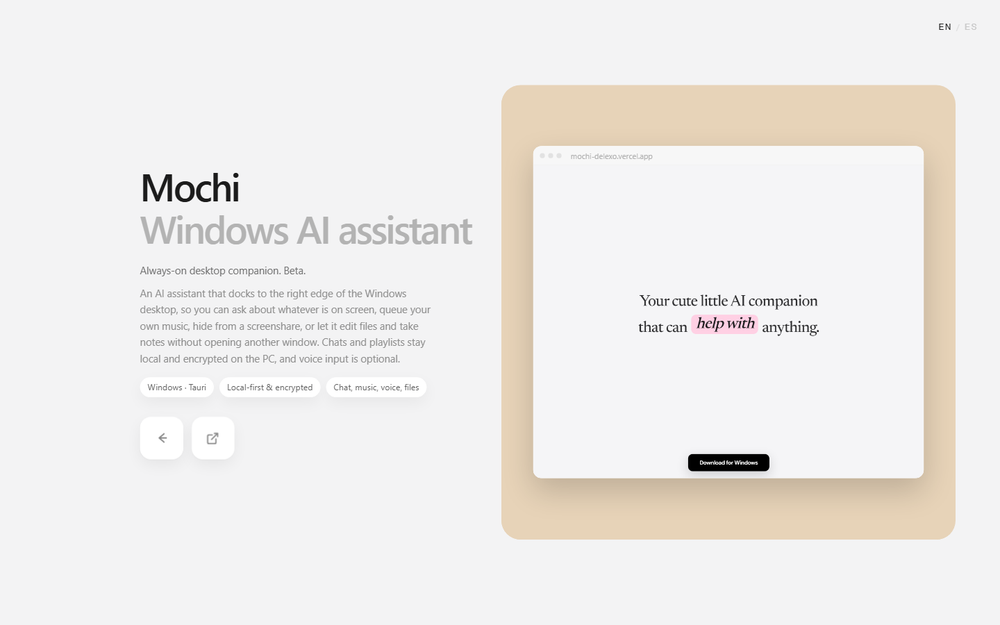
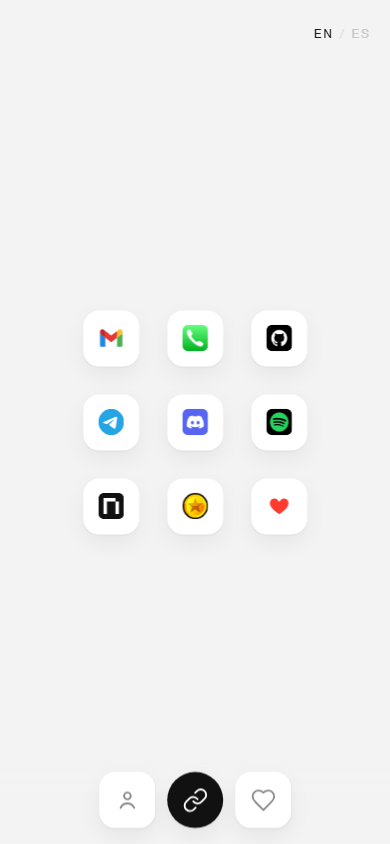

<div align="center">

# Delexo

**Just a simple portfolio.**

[**Live site → delexo.store**](https://delexo.store)


</div>



---

## Overview

A single-page personal site built with plain HTML, CSS and JavaScript — no framework, no build step, no dependencies.

The home screen is an infinite deck of projects. Opening one expands it into a case view with the write-up, short tags, and live / repo links. Profile and Links live on the same stage: the deck slides aside, and every transition is CSS or Web Animations.

Profile content (skills, certificates, stack, and an app-style project list) sits in expandable dropdowns under the bio. The whole site is bilingual (English / Spanish), remembers your language choice, works from phones to wide desktops, and respects `prefers-reduced-motion`.

## Projects

| | Project | What it is |
|---|---|---|
| 01 | **Mochi** | A Windows AI assistant that docks to the desktop edge: chat, music, voice and file actions, local-first. |
| 02 | **Moonrise** | One-click AI websites for local businesses, with built-in checkout for selling them. |
| 03 | **Free University Tools** | A curated directory of free and free-tier tools for students. |
| 04 | **OrbINT** | An open-source reconnaissance casebook that keeps identifiers in one local case file. |
| 05 | **MusicWidget** | A 4 MB always-on-top music player for Windows with plain-folder playlists. |
| 06 | **GitReplay** | Replays any GitHub repository character by character, with a live HTML/CSS/JS preview. |
| 07 | **Vibe Code Checklist** | A ship-readiness checklist for vibe-coded web apps (manual or agent). |
| 08 | **Capes++** | A Minecraft Java Edition cape customizer with 75+ capes and full source. |

## Features

- **Infinite project deck:** wheel, trackpad, arrow keys or the dots step through projects; the deck wraps cleanly.
- **Expanded project view:** title, summary, tags, live site and repository, with a scale morph in and out.
- **Profile view:** bio plus expandable Skills, Certificates, Stack, and Projects branches.
- **Links view:** contact and social icons in one place, each opening in a new tab.
- **Bilingual copy:** full English and Spanish content, persisted in `localStorage`.
- **Custom cursor and tooltips:** a lightweight pointer and contextual labels on fine pointers only.
- **Discord profile card:** the Discord link opens a small friend-request style dialog.
- **Mobile layout:** pinned action bar with safe-area padding and staggered info reveals.

## Preview

<div align="center">
  
</div>

## Structure

```text
.
├── index.html                 # markup, OG embed tags, favicon
├── CNAME                      # custom domain for GitHub Pages
├── .nojekyll                  # keep Pages from running Jekyll
├── .well-known/               # Discord domain verification
├── css/
│   ├── base.css               # tokens, reset, cursor, stage shell
│   ├── components.css         # actions, notes, prose, branches, lists
│   ├── deck.css               # panel, portrait, cards, browser frames, dots
│   ├── responsive.css         # mobile layout (<= 980px)
│   ├── discord.css            # Discord profile dialog
│   └── motion.css             # keyframes and reduced-motion overrides
├── js/
│   ├── copy.js                # English / Spanish interface strings
│   ├── data.js                # projects, stack, socials
│   ├── core.js                # shared state and helpers
│   ├── ui.js                  # identity, actions, links, profile painters
│   ├── deck.js                # card markup, deck placement, project slides
│   ├── motion.js              # flip, shrink, cluster transitions
│   ├── navigation.js          # paint(), view changes, language, stepping
│   ├── events.js              # click, keyboard, wheel, cursor
│   └── main.js                # boots the app
├── assets/
│   ├── D.png                  # circular Delexo favicon
│   ├── apps/                  # project app glyphs for the Profile list
│   ├── icons/                 # stack marks
│   ├── schools/               # CSUSM / Harvard tip marks
│   ├── socials/               # Links icons
│   ├── discord/               # Discord card art
│   └── *.{webp,gif}           # project deck thumbnails
└── .github/
    └── preview-*.png          # README screenshots
```

## Local development

Nothing to install or build. Serve the folder over HTTP:

```bash
python3 -m http.server 3000
```

Open <http://localhost:3000>. Any static server works.

## Editing content

| What | Where |
|---|---|
| Project names, links, thumbnails, icons, write-ups | `js/data.js` → `projects` |
| English / Spanish interface copy and bio | `js/copy.js` → `copy.en` / `copy.es` |
| Skills and certificates | `js/copy.js` → `skillItems` / `certItems` |
| Stack icons | `js/data.js` → `stack` |
| Social and contact links | `js/data.js` → `socials` |
| Donate destination | `js/data.js` → `stripeHref` |
| Discord / Open Graph embed text | `index.html` `<meta>` tags |

Bump the `?v=` query on `css/` and `js/` links in `index.html` after styling or behaviour changes so returning visitors get the new build.

## Deployment

Served by GitHub Pages from the root of `main`:

1. Push to `main`.
2. GitHub Pages rebuilds automatically.
3. `CNAME` keeps it on [delexo.store](https://delexo.store) with HTTPS.

## Links

[Website](https://delexo.store) · [GitHub](https://github.com/Delexoo) · [OrbINT](https://orbint.net)

<div align="center"><sub>Just a simple portfolio.</sub></div>
